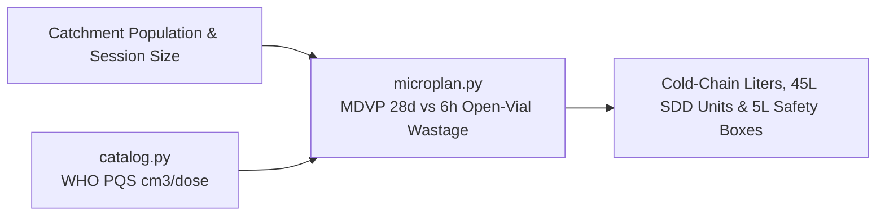

# epi-microplan

[](https://github.com/codesphere-u/epi-microplan/actions/workflows/ci.yml)
[](LICENSE)
[](pyproject.toml)
[](pyproject.toml)

**Zero-dependency WHO EPI district immunization microplanner: session-driven open-vial wastage (MDVP 28-day vs 6-hour lyophilized), packed cold-chain volume, SDD/ILR fridge sizing, and AD syringe safety-box planner.**

- **Mission Domain:** Healthcare & Immunization Supply Chain (WHO EPI)
- **Stack:** Pure Python 3.11+ (zero runtime third-party dependencies, `mypy --strict`, `ruff`, `pytest`)
- **Maintainer:** Codesphere Innovations (U) Limited (`codesphere-u`)

---

## Problem Solved

District immunization planners frequently under-size solar cold-chain fridges when introducing high-volume vaccines (Rotavirus, PCV-13, Malaria R21) or overlook >70% open-vial wastage of 10-dose lyophilized Measles/BCG vials at small rural sessions.

## Key Features

- WHO PQS 10-antigen catalog (`bcg`, `bopv`, `ipv`, `pentavalent`, `pcv13`, `rotavirus`, `measles_rubella`, `measles_rubella_5dose`, `yellow_fever`, `malaria_r21`) with packed `cm3/dose` and diluent volumes.
- Session-size open-vial wastage simulator (`estimate_open_vial_wastage`) distinguishing 6-hour lyophilized discard from 28-day MDVP liquid retention and recommending 5-dose vial switches.
- End-to-end district microplan (`build_district_microplan`) calculating net `+2..+8C` fridge deficits, recommended 45L Solar Direct-Drive (SDD) units, 2.6L outreach carriers, AD syringes, and 5L sharps safety boxes.

## Architecture Overview



See [docs/architecture.md](docs/architecture.md) for module-level design details.

## Installation

```bash
git clone https://github.com/codesphere-u/epi-microplan.git
cd epi-microplan
uv sync --extra dev
```

Or install in editable mode with standard `pip`:

```bash
pip install -e ".[dev]"
```

## Quick Start (CLI)

```bash
epi-microplan --population 45000 --session-size 8 --fridge-liters 45
```

## Quick Start (Python API)

```python
from epi_microplan import FacilitySupplySpec, build_district_microplan

plan = build_district_microplan(FacilitySupplySpec('HC3', catchment_population=30000, existing_fridge_net_liters=90))
assert plan.total_required_cold_chain_liters > 0 and plan.safety_boxes_5l_required > 0
```

## Testing & Quality Gates

```bash
uv run ruff check src tests
uv run mypy src
uv run pytest -v
```

## Security, Contributing & Roadmap

- **Security:** See [SECURITY.md](SECURITY.md) for responsible disclosure procedures.
- **Contributing:** See [CONTRIBUTING.md](CONTRIBUTING.md) and [CODE_OF_CONDUCT.md](CODE_OF_CONDUCT.md).
- **Changelog & Roadmap:** See [CHANGELOG.md](CHANGELOG.md) and [ROADMAP.md](ROADMAP.md).

## License

MIT License — see [LICENSE](LICENSE).

## Support & Contact

Open an issue on [GitHub Issues](https://github.com/codesphere-u/epi-microplan/issues) or contact `codesphereinnovationz@gmail.com`.
